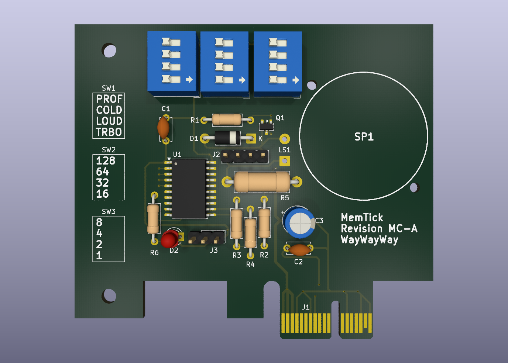
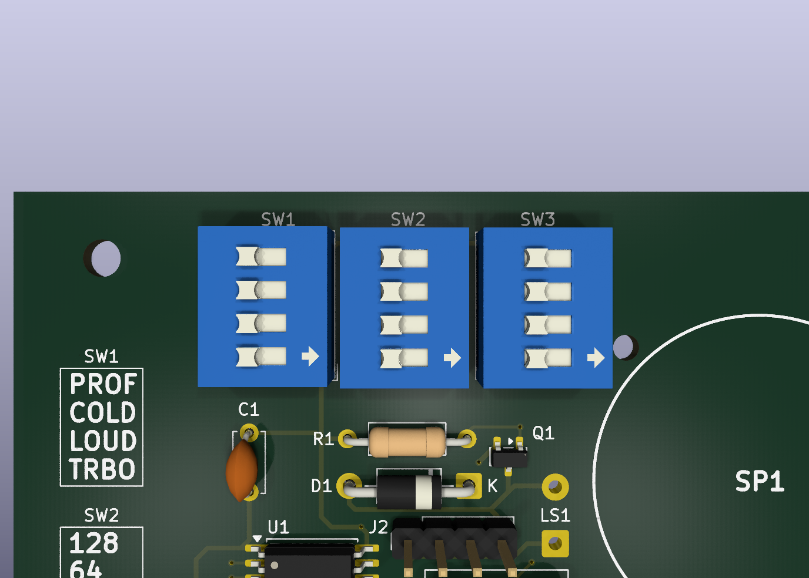

# MemTick: A 486 Heartbeat for the Modern PC

MemTick is a low-profile PCIe x1 card that brings back the sound of an early
1990s PC starting up: the fast ticking of the AMI BIOS memory count, followed
by the single POST beep that said all was well. Set your installed RAM on the
DIP switches, and every time your modern PC powers on or resets, MemTick counts
through your memory with that familiar rattle of ticks and finishes with the beep.

No drivers, no software, no USB cable. The operating system never knows it's
there, so it works with Windows, Linux or anything else that boots.

**Status:** Rev MC-A boards are in production. Untested on hardware so far;
first power-up and a demo video are coming soon.

## Why

If you grew up with a 386 or 486, you remember that sound. Before anything
showed up on screen, the machine told you it was alive: the memory counted up,
it beeped, and then the boot began. It was the heartbeat of the computer.

Modern PCs boot in silence. UEFI skips the memory count, most cases no longer
include a speaker, and many motherboards have dropped the speaker header
completely. MemTick puts that heartbeat back into a modern build without giving
up anything modern.

## How it works

The card takes only power and one reset signal from the PCIe slot. It never
touches the data lanes, so it cannot interfere with the system.

- **Brain:** an ATtiny3216 microcontroller runs from the slot's 3.3 V supply.
- **Knowing when the PC boots:** every PCIe slot carries PERST#, a reset line
  the motherboard holds low until the system starts. MemTick watches it. When
  reset is released, the count begins. Press reset partway through and MemTick
  stops and starts over, just like the real thing.
- **Sound:** an AO3400A MOSFET switches the speaker from the slot's 12 V supply
  through a 68 Ω, 2 W current-limiting resistor, with a 1N4001 flyback diode for
  protection. Each tick is a short pulse; the beep is a tone near 900 Hz, close
  to the on-board speaker's resonant frequency.
- **Speaker choice:** a 28 mm speaker mounts on the card with two M2 screws, or
  connect your case's front-panel speaker to the J2 header instead.
- **Safety:** a watchdog timer turns the speaker off if the firmware ever hangs.

The full schematic is in [`Memtick-PCIe-MC.pdf`](Memtick-PCIe-MC.pdf).

## Settings

Three 4-position DIP switches set everything. The legend is printed on the
board next to each switch.

**SW1: options**

| Switch | Name | When ON |
|---|---|---|
| TRBO | Turbo | Count runs at double speed |
| LOUD | Loud | Full volume (OFF gives a softer level) |
| COLD | Cold boot only | Count plays only on the first boot after power-on; warm resets stay quiet |
| PROF | Profile | Count starts slow and speeds up, like older machines testing their first block of memory |

**SW2 and SW3: memory size in GB**

Turn on the switches that add up to your installed RAM. Any size from 1 to
255 GB can be set.

| Switch | SW2 | SW3 |
|---|---|---|
| Values | 128, 64, 32, 16 | 8, 4, 2, 1 |

| Installed RAM | Switches ON |
|---|---|
| 8 GB | 8 |
| 16 GB | 16 |
| 32 GB | 32 |
| 48 GB | 32, 16 |
| 64 GB | 64 |
| 96 GB | 64, 32 |
| 128 GB | 128 |

## Hardware

- Low-profile PCIe x1 board, 78.5 x 68.9 mm, 2 layers, 1.6 mm FR-4, ENIG finish
  with bevelled gold fingers
- Mostly through-hole parts; only the ATtiny3216 (SOIC-20) and the AO3400A
  (SOT-23) are surface mount
- 3-pin UPDI header (J3) for programming and firmware updates
- 4-pin case speaker header (J2): pin 1 speaker +, pin 4 speaker -
- Status LED

Parts list: [`MemTick-RevMC-A-BOM.csv`](MemTick-RevMC-A-BOM.csv), with DigiKey
part numbers.

## Building one

The step-by-step guide is in
[`MemTick-RevMC-A-Assembly.md`](MemTick-RevMC-A-Assembly.md): solder order,
polarity of each part, first power-up checks and programming.

To order boards, upload the zip of the [`gerbers/`](gerbers) folder to your PCB
maker, or order directly from the
[PCBWay project page](https://www.pcbway.com/project/shareproject/W1012940AS3P3_MemTick_Core_MC_RevA_2d2023c9.html).
Choose 1.6 mm thickness, ENIG, and gold fingers bevelled at 30°.

## Firmware

The firmware is in [`MemTick/MemTick.ino`](MemTick/MemTick.ino). It is written
in C++ for the Arduino IDE with
[megaTinyCore](https://github.com/SpenceKonde/megaTinyCore). Timing and volume
values are grouped at the top of the file so they're easy to adjust.

### Programming

**Always program the card outside the PC.**

1. In the Arduino IDE, add this URL under **File > Preferences > Additional
   Boards Manager URLs**:
   `http://drazzy.com/package_drazzy.com_index.json`
2. Install **megaTinyCore** from **Tools > Board > Boards Manager**.
3. Under **Tools**, set:
   - Board: **ATtiny3216/1616/1606/816/806/416/406**
   - Chip: **ATtiny3216**
   - Clock: **8 MHz internal**
4. Connect a UPDI programmer to J3:

   | J3 pin | Signal |
   |---|---|
   | 1 (square pad) | UPDI |
   | 2 | GND |
   | 3 | +3.3V |

5. Choose your programmer under **Tools > Programmer** and use
   **Sketch > Upload Using Programmer**.

Any UPDI programmer works. Two easy options:

- **SerialUPDI:** a USB-to-serial adapter (CH340 or CP2102) with a 4.7 kΩ
  resistor between TX and RX. Select **SerialUPDI** as the programmer.
- **jtag2updi:** an Arduino Pro Micro (5V/16MHz) flashed with jtag2updi. Select
  **jtag2updi** as the programmer.

## Repository contents

| Path | Contents |
|---|---|
| `Memtick-PCIe-MC.kicad_pro`, `.kicad_sch`, `.kicad_pcb` | KiCad 10 project |
| `Memtick-PCIe-MC.pdf` | Schematic |
| `gerbers/` | Gerber and drill files for Rev MC-A |
| `MemTick/` | Firmware and its MIT license |
| `MemTick-RevMC-A-BOM.csv` | Bill of materials |
| `MemTick-RevMC-A-Assembly.md` | Assembly guide |
| `*.png` | Board renders |

## License

- **Hardware and documentation:** [CC BY-SA 4.0](LICENSE)
- **Firmware:** [MIT](MemTick/LICENSE)

You may build, modify and sell MemTick boards. Please credit
"MemTick by Todd Hahn" and share modified designs under the same license.
Details are in [`LICENSING.md`](LICENSING.md).

## Thanks

A big thank-you to [PCBWay](https://www.pcbway.com) for sponsoring the first
run of MemTick boards.

## Links

- [PCBWay project page](https://www.pcbway.com/project/shareproject/W1012940AS3P3_MemTick_Core_MC_RevA_2d2023c9.html)
- [Hackaday.io](https://hackaday.io/projects/hacker/1922058)
